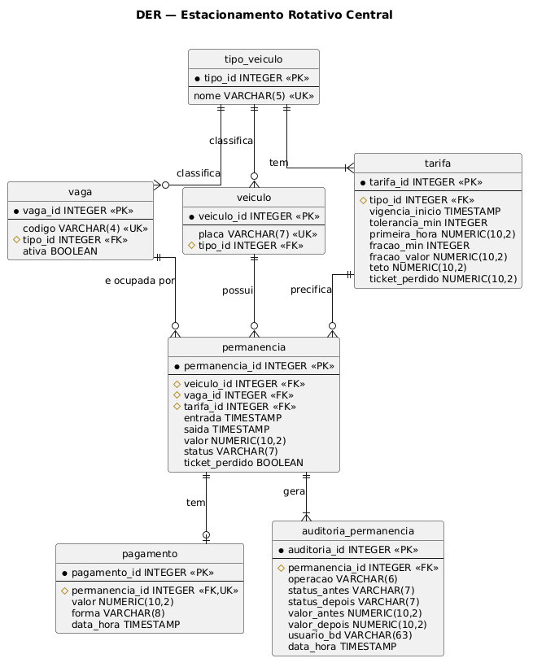

# Estacionamento Rotativo Central

A3 — Projeto Integrador de Banco de Dados (2026/2).

Sistema de banco de dados para um estacionamento rotativo fictício com **100 vagas de carro e 20 de moto**. O problema: o controle manual gera saída sem cobrança, tarifa calculada errado, ticket perdido sem registro e nenhuma visão de ocupação/receita. O banco resolve isso com tarifa por tempo, tolerância, controle de lotação, pagamento e auditoria.

**Stack:** PostgreSQL 17, Java 21 (Maven/JDBC), JUnit 5 e Docker Compose.

> A modelagem (A1–A6) está fechada neste README; performance, aplicação e log de IA são acrescentados nas Frentes B, C e D. Em caso de divergência, [`decisions.md`](decisions.md) vence.

## Estado atual

- **Frente A concluída:** DER, DDL, seed com fronteiras, subida limpa, 4 testes JUnit de constraints e documentação de modelagem.
- `decisions.md` validado e congelado para agentes/IA; o grupo só altera com justificativa registrada.
- `docker/postgres-init.sh` executa os scripts na primeira subida do volume.
- `postgresql/03_consultas.sql` já contém Q01–Q10; `04_indices` e `procedures/` ainda são placeholders (Frentes B e C).
- Subida limpa do compose validada (`down -v` + `up -d --wait` sem erro, healthcheck `healthy`) e suíte JUnit com 4/4 testes passando.
- Serviço `testes` já disponível; serviço `app` entra na Frente C.

## Como rodar

Pré-requisito: Docker com Compose.

```bash
docker compose down -v      # apaga o volume e força a reinicialização
docker compose up -d --wait # sobe o PostgreSQL e roda o init
docker compose run --rm testes # suíte JUnit (Frente A em diante)
```

Conferir o banco:

```bash
docker compose exec postgres psql -U estacionamento -d estacionamento
```

Derrubar tudo:

```bash
docker compose down -v
```

### Credenciais de laboratório

- Banco: `estacionamento`
- Usuário: `estacionamento`
- Senha: `estacionamento_pwd`
- Porta: `${PG_PORT:-5432}` (use `PG_PORT=5433` se a 5432 estiver ocupada)

São credenciais de laboratório, não de produção.

## Regras de negócio

Regras fechadas no [`decisions.md`](decisions.md) §2 — este bloco é uma cópia para leitura; em caso de divergência, o `decisions.md` vence.

| ID | Regra |
|---|---|
| RN-01 | Entrada só com vaga ativa livre do tipo do veículo. |
| RN-02 | Permanência ≤ 15 min é gratuita; 15:01 já cobra. |
| RN-03 | Carro: 1ª hora R$ 12; cada fração iniciada de 30 min após a 1ª hora R$ 4; teto R$ 45. |
| RN-04 | Moto: 1ª hora R$ 8; fração R$ 3; teto R$ 30. |
| RN-05 | Ticket perdido: R$ 60 (carro) / R$ 40 (moto), sobrepondo a tarifa por tempo. |
| RN-06 | Veículo só ocupa vaga do mesmo tipo; vaga inativa não recebe. |
| RN-07 | No máximo 1 permanência aberta por veículo e nenhuma sobreposição de permanências na mesma vaga. |
| RN-08 | Saída só fecha com valor 0 ou com pagamento integral; permanência fechada não reabre e o valor não muda. |
| RN-09 | Formas de pagamento: `DINHEIRO`, `PIX`, `CARTAO`. Valor 0 não gera linha em `PAGAMENTO`. |
| RN-10 | Operação 24h; o teto é por permanência. |

Onde cada regra é imposta: RN-01, RN-06 e RN-07 pela procedure `registrar_entrada` e pelos triggers; RN-02 a RN-05, RN-08 e RN-09 pela `registrar_saida`; RN-10 pelo cálculo de tempo (Frentes C e B).

## Dados de exemplo (A3)

Seed em [`postgresql/02_inserts.sql`](postgresql/02_inserts.sql), executado pelo init logo após o DDL. Contagens impressas na subida limpa (`docker compose down -v && docker compose up -d --wait`, init sem erro):

| Tabela / recorte | Linhas |
|---|---:|
| `tipo_veiculo` | 2 |
| `tarifa` | 2 |
| `vaga` | 120 |
| `veiculo` | 31 |
| `permanencia` | 31 |
| `permanencia` ABERTA | 14 |
| `permanencia` FECHADA | 17 |
| `pagamento` | 15 |

Fronteiras cobradas (duração exata calculada no banco, valor gravado no seed):

| Duração | Carro | Moto |
|---|---:|---:|
| 15:00 | R$ 0,00 (tolerância) | R$ 0,00 (tolerância) |
| 15:01 | R$ 12,00 | R$ 8,00 |
| 60:00 | R$ 12,00 | R$ 8,00 |
| 60:01 | R$ 16,00 | R$ 11,00 |
| 90:00 | R$ 16,00 | R$ 11,00 |
| 90:01 | R$ 20,00 | R$ 14,00 |
| 5h00:00 | R$ 44,00 | R$ 30,00 (teto) |
| 5h00:01 | R$ 45,00 (teto) | — |
| ticket perdido (45:00) | R$ 60,00 | R$ 40,00 |

Verificação no PostgreSQL 17: **0** divergências entre o valor semeado e o valor recalculado pela tarifa congelada nas 17 permanências fechadas; **0** pagamentos com valor diferente da permanência ou gerados para valor 0; **0** permanências com tipo de veículo diferente do tipo da vaga, **0** sobreposições na mesma vaga e **0** veículos com duas permanências abertas. Q01 devolve CARRO 100/10 ocupadas e MOTO 20/4 ocupadas. Q03 tem empate na posição 10 (duas placas com R$ 12,00), por isso `RANK()` devolve 11 linhas com `posicao <= 10`. `C100` e `M020` aparecem como vagas nunca utilizadas. Pagamentos: `DINHEIRO` 5 / R$ 110,00, `PIX` 6 / R$ 136,00, `CARTAO` 4 / R$ 101,00, em dois meses (outubro R$ 115,00 e novembro R$ 232,00 na subida de 24/11/2026). As datas são relativas a `CURRENT_DATE`/`CURRENT_TIMESTAMP`, portanto os totais por mês acompanham a data da subida.

## Subida limpa (A4)

`docker compose down -v && docker compose up -d --wait` terminou com `EXIT_COPOSE=0`, container `Up (healthy)` e log do init sem `ERROR`:

```text
[init] executando /scripts/postgresql/01_ddl.sql
[init] executando /scripts/postgresql/02_inserts.sql
[init] executando /scripts/procedures/postgresql_procedures.sql
[init] executando /scripts/postgresql/04_indices.sql
[init] concluído.
```

Conferência no `psql` (`PostgreSQL 17.12`): **7** tabelas no schema `public`; **7** constraints `pk_`, **5** `uk_`, **8** `fk_` e **15** `ck_`, nenhuma fora do padrão de nome; as 8 FKs têm `confdeltype = r` (`ON DELETE RESTRICT`); índice `uk_permanencia_veiculo_aberta` definido como `CREATE UNIQUE INDEX ... ON public.permanencia USING btree (veiculo_id) WHERE ((status)::text = 'ABERTA'::text)`. Contagens: `tipo_veiculo=2`, `vaga=120`, `veiculo=31`, `tarifa=2`, `permanencia=31`, `pagamento=15`, `auditoria_permanencia=0`. `SELECT`s de conferência mostraram as tarifas (carro 15/12/30/4/45/60 e moto 15/8/30/3/30/40), as permanências `C001` (R$ 0,00), `C002` (R$ 12,00), `C009` (ticket perdido, R$ 60,00), `C010` (ABERTA, entrada há 10 horas) e `M008` (ticket perdido, R$ 40,00), além de 10 vagas de carro ocupadas.

Aborto do init confirmado nas duas pontas: injetando `SELECT 1/0;` no fim de `01_ddl.sql` e, em outra subida, no fim de `04_indices.sql`, `docker compose up -d --wait` devolveu `EXIT_COPOSE=1`, o container ficou `Exited (3)`, o log mostrou `ERROR: division by zero` e **não** mostrou `[init] concluído.`. Os arquivos foram restaurados e a subida limpa foi repetida com sucesso (estado final `healthy`).

## Testes de DDL/constraints (A5)

Projeto Maven em [`app/`](app/): Java 21, driver PostgreSQL e JUnit 5. O serviço `testes` (perfil `testes`) usa [`docker/Dockerfile.testes`](docker/Dockerfile.testes) com `maven:3.9-eclipse-temurin-21`, monta `./app` em `/app` e recebe `DB_URL`, `DB_USER` e `DB_PASSWORD` do compose; `depends_on` espera o `postgres` ficar `healthy`. A conexão JDBC usa `autoCommit=false`, `rollback()` ao final de cada teste e `Savepoint` antes de cada inserção que deve falhar, para que o erro não deixe a transação abortada. Valores são passados por bind (`?`), sem concatenação.

Quatro testes em [`app/src/test/java/br/estacionamento/DdlConstraintTest.java`](app/src/test/java/br/estacionamento/DdlConstraintTest.java):

| Teste | Validação |
|---|---|
| `constraintsSaoNomeadas` | 7 `pk_`, 5 `uk_`, 8 `fk_` e 15 `ck_` no catálogo; 0 fora do padrão de nome. |
| `placaInvalidaBarrada` | `ABC-123` gera `23514` e `ck_veiculo_placa`. |
| `saidaIgualOuAnteriorEntradaBarrada` | `saida = entrada` gera `23514` e `ck_permanencia_saida`. |
| `pagamentoDuplicadoBarrado` | 2º pagamento da mesma permanência gera `23505` e `uk_pagamento_permanencia`. |

Saída real de `docker compose down -v && docker compose up -d --wait && docker compose run --rm testes`: `UP_EXIT=0`, `TESTES_EXIT=0`, `Tests run: 4, Failures: 0, Errors: 0, Skipped: 0` e `BUILD SUCCESS` (PostgreSQL 17.12). O container `postgres` permanece `healthy`.

## DER e Decisões de Modelagem



Arquivo-fonte: [`der/estacionamento.puml`](der/estacionamento.puml); imagem exportada em `der/estacionamento.png`. O DER usa as mesmas cardinalidades do DDL e do `decisions.md` §3.

### As 7 tabelas e seu papel

| Tabela | Papel no domínio | Chaves e regras estruturais |
|---|---|---|
| `tipo_veiculo` | Domínio fechado `CARRO` / `MOTO`. | PK `tipo_id`; UK `nome`; CHECK no nome. |
| `vaga` | Inventário de 100 vagas de carro e 20 de moto; não guarda ocupação. | PK `vaga_id`; UK `codigo` (`^[CM][0-9]{3}$`); FK `tipo_id`; `ativa`. |
| `veiculo` | Veículo anônimo, identificado apenas pela placa; criado na primeira entrada. | PK `veiculo_id`; UK `placa` (`^[A-Z]{3}[0-9][A-Z0-9][0-9]{2}$`); FK `tipo_id`. |
| `tarifa` | Regras de preço por vigência; insert-only (nova vigência = nova linha). | PK `tarifa_id`; UK `(tipo_id, vigencia_inicio)`; tolerância, 1ª hora, fração (minuto e valor), teto e ticket perdido. |
| `permanencia` | Entidade associativa **com estado** entre veículo e vaga; congela a tarifa da entrada. | PK `permanencia_id`; FKs `veiculo_id`, `vaga_id`, `tarifa_id`; `entrada`, `saida`, `valor`, `status`, `ticket_perdido`; CHECKs de data, valor e consistência `ABERTA`↔`saida NULL`; índice único parcial de uma aberta por veículo. |
| `pagamento` | Quitação integral da permanência; valor 0 não gera linha. | PK `pagamento_id`; FK + UK `permanencia_id` (0..1); `valor > 0`; `forma` em `DINHEIRO`/`PIX`/`CARTAO`; `data_hora`. |
| `auditoria_permanencia` | Log gravado por trigger (INSERT e mudanças de `status`/`valor`). | PK `auditoria_id`; FK `permanencia_id` (1..N); antes/depois, `usuario_bd`, `data_hora`; sem UK porque é histórico de eventos. |

Leitura da N:M: um veículo pode usar várias vagas ao longo do tempo e uma vaga pode receber vários veículos, mas a relação só existe como `permanencia`, com `entrada`, `saida`, `valor` e `status`. Ocupação atual é derivada das permanências `ABERTA` (Q01), não de um campo em `vaga`.

### Cardinalidades (mín., máx.)

| Relação | Card. | Leitura |
|---|---|---|
| `tipo_veiculo` → `vaga` | (1,1) — (0,N) | Um tipo tem 0..N vagas; toda vaga tem exatamente 1 tipo. |
| `tipo_veiculo` → `veiculo` | (1,1) — (0,N) | Um tipo tem 0..N veículos; todo veículo tem exatamente 1 tipo. |
| `tipo_veiculo` → `tarifa` | (1,1) — (1,N) | Um tipo tem 1..N tarifas (insert-only, uma por vigência); toda tarifa tem 1 tipo. |
| `veiculo` → `permanencia` | (1,1) — (0,N) | Um veículo tem 0..N permanências; toda permanência tem 1 veículo. |
| `vaga` → `permanencia` | (1,1) — (0,N) | Uma vaga tem 0..N permanências; toda permanência tem 1 vaga. |
| `tarifa` → `permanencia` | (1,1) — (0,N) | Uma tarifa congela 0..N permanências; toda permanência referencia 1 tarifa. |
| `permanencia` → `pagamento` | (1,1) — (0,1) | Uma permanência tem 0..1 pagamento (valor 0 não gera linha); todo pagamento tem 1 permanência. |
| `permanencia` → `auditoria_permanencia` | (1,1) — (1,N) | Toda permanência gera 1..N registros de auditoria; todo registro pertence a 1 permanência. |

`veiculo` ↔ `vaga` é **N:M** resolvida por `permanencia` — a associativa carrega `entrada`, `saida`, `valor` e `status` (entidade **com estado**).

### Decisões de modelagem

| Decisão | Por quê |
|---|---|
| **`PERMANENCIA` é entidade, não atributo** | Ela carrega estado próprio (`entrada`, `saida`, `valor`, `status`, `ticket_perdido`) e é a associativa **com estado** da N:M. Uma vaga pode ter muitas permanências no tempo e um veículo também; nenhum dos dois "guarda" a outra. |
| **Ocupação é derivada (sem status em `VAGA`)** | Status armazenado em `VAGA` fica desatualizado e permite duas fontes de verdade. A ocupação atual é `COUNT` de permanências `ABERTA` por vaga — Q01. |
| **Tarifa congelada por `tarifa_id`** | A permanência referencia a tarifa vigente na **entrada**. Como `tarifa` é insert-only (preço novo = linha nova), recalcular depois não muda o histórico. |
| **Todas as FKs `ON DELETE RESTRICT`** | Impede apagar tipo, vaga, veículo ou tarifa com dados dependentes. Nada de `CASCADE`: apagar histórico silenciosamente quebraria auditoria e receita. |
| **Sem entidade `CLIENTE`** | Escopo é rotativo avulso, sem mensalistas e sem reserva. Não há dado de pessoa a guardar; `veiculo` é anônimo, identificado só pela placa. |
| **Sem código de ticket** | O ticket não é entidade: `ticket_perdido` é um booleano em `PERMANENCIA` que dispara tarifa fixa (RN-05). |
| **`auditoria_permanencia` não tem `UK`** | É log de eventos: a mesma permanência pode gerar várias linhas (INSERT + updates de `status`/`valor`). |

### Normalização

O modelo chega à **3FN** sem tabelas fora do `decisions.md`:

- **1FN:** todos os atributos são atômicos. Não há coluna repetida por forma de pagamento (o domínio `DINHEIRO`/`PIX`/`CARTAO` é um CHECK em `pagamento.forma`), nem lista de vagas em veículo. Datas e valores usam `TIMESTAMP`, `DATE` e `NUMERIC(10,2)`.
- **2FN:** as 7 tabelas têm PK de uma única coluna (`INTEGER GENERATED BY DEFAULT AS IDENTITY`), portanto não existe dependência parcial de chave composta. O UK composto de `tarifa` (`tipo_id`, `vigencia_inicio`) não é PK: os atributos de preço dependem da vigência **do tipo**, não só do tipo.
- **3FN:** atributos descritivos dependem da chave da própria tabela. `tipo_veiculo.nome` fica em `tipo_veiculo` e não é repetido como texto em `vaga`, `veiculo` ou `tarifa` — elas referenciam `tipo_id`. `permanencia` guarda o que é do evento (entrada, saída, valor, status), `pagamento` guarda o que é do pagamento e `auditoria_permanencia` guarda o que é do log. Fora as redundâncias históricas listadas abaixo, não há atributo derivado de outra tabela que pudesse divergir dela.

Redundâncias mantidas de propósito, todas com justificativa no modelo:

| Aparente redundância | Por que não é erro de normalização |
|---|---|
| `permanencia.valor` + `tarifa` | O preço é congelado na entrada pelo `tarifa_id` e o valor cobrado fica no evento. Como `tarifa` é insert-only, o histórico não muda quando há nova vigência. |
| `permanencia.status` + `saida` | `status` é estado explícito, usado pelo índice único parcial e pelas consultas; o CHECK `ck_permanencia_status_saida` impede que os dois discordem (`ABERTA` ⇔ `saida IS NULL`). |
| `auditoria_permanencia.status_antes/depois` e `valor_antes/depois` | É log temporal: guarda o que era e o que passou a ser no evento, não uma cópia substituível da linha atual. |
| `pagamento.permanencia_id` com FK + UK | É a cardinalidade 0..1: no máximo um pagamento por permanência; valor 0 não gera pagamento (RN-09). |

Não há campos de cliente, mensalidade, reserva ou status em `vaga` porque estão fora do escopo fechado em `decisions.md` §1–§3.

## Consultas Q01–Q10 (B1)

Arquivo: [`postgresql/03_consultas.sql`](postgresql/03_consultas.sql), com um marcador `-- @Qnn` por consulta. Execução real: `docker compose exec -T postgres psql -X -v ON_ERROR_STOP=1 -U estacionamento -d estacionamento -f /scripts/postgresql/03_consultas.sql` → `PSQL_EXIT=0`, 10 consultas, sem erro. Técnicas exigidas presentes: 6 consultas com JOIN, 4 funções de janela (`SUM() OVER`, `RANK() OVER`, `SUM(SUM()) OVER ()`, `LAG() OVER`), agregações em todas, `NOT EXISTS` em Q07 e `GROUP BY ROLLUP` em Q10.

Resultados reais da subida com dados semeados em 24/11/2026 e consultas executadas em 25/11/2026 (datas relativas mudam com o dia da subida):

| Consulta | Resultado real |
|---|---|
| Q01 | CARRO: total 100, ocupadas 10, livres 90, 10,00%. MOTO: total 20, ocupadas 4, livres 16, 20,00%. |
| Q02 | 5 dias com pagamento: 19/11 R$ 25,00 (acum. 25,00); 20/11 R$ 36,00 (61,00); 21/11 R$ 47,00 (108,00); 22/11 R$ 20,00 (128,00); 23/11 R$ 104,00 (232,00). |
| Q03 | 11 linhas (empate na posição 10): 1 ABC9E01 60,00; 2 ABC8D90 45,00; 3 ABC7D89 44,00; 4 MOT8H90 40,00; 5 MOT7G89 30,00; 6 ABC6D78 20,00; 7 ABC4D56 16,00; 7 ABC5D67 16,00; 9 MOT6F78 14,00; 10 ABC2D34 12,00; 10 ABC3D45 12,00. |
| Q04 | CARRO: média 108,34 min, mínimo 15,00, máximo 300,02. MOTO: média 84,38 min, mínimo 15,00, máximo 300,00. |
| Q05 | 16 horas com movimento (6–22); soma de entradas = 31 (todas as permanências) e de saídas = 17 (fechadas). |
| Q06 | `CARTAO` R$ 101,00 (29,11%); `DINHEIRO` R$ 110,00 (31,70%); `PIX` R$ 136,00 (39,19%). Total R$ 347,00. |
| Q07 | 89 vagas nunca utilizadas: `C020`–`C100` (81 carros) e `M013`–`M020` (8 motos), incluindo as fronteiras `C100` e `M020`. |
| Q08 | `COBRADO` 13 / R$ 247,00; `TICKET_PERDIDO` 2 / R$ 100,00; `TOLERANCIA` 2 / R$ 0,00. |
| Q09 | 2026-10: R$ 115,00, anterior `NULL`, variação `NULL`. 2026-11: R$ 232,00, anterior R$ 115,00, variação 101,74%. |
| Q10 | CARRO: CARTAO 60,00 / DINHEIRO 88,00 / PIX 77,00 / subtotal 225,00. MOTO: CARTAO 41,00 / DINHEIRO 22,00 / PIX 59,00 / subtotal 122,00. Total geral 347,00. |

Conferência de consistência: as receitas de Q02 (232,00 no mês corrente), Q06 (347,00 no total) e Q10 (347,00) batem com a soma dos pagamentos; Q08 (13 + 2 + 2) cobre as 17 permanências fechadas.

### Resultados esperados calculados à mão (B2)

Derivação a partir do seed, antes de comparar com a saída real do B1. Seja `S` o dia da subida; as permanências antigas usam `S-1` a `S-5` e as do mês anterior usam o dia 1 do mês corrente menos 10 dias. Valores em R$.

| Consulta | Conta feita à mão | Esperado |
|---|---|---|
| Q01 | 100 vagas `C` ativas; abertas `C010`–`C019` = 10. 20 vagas `M` ativas; abertas `M009`–`M012` = 4. | CARRO 100/10/90/10,00%; MOTO 20/4/16/20,00%. |
| Q02 | `S-5`: M005 11 + M006 14 = 25. `S-4`: C005 16 + C006 20 = 36. `S-3`: C003 12 + C004 16 + M003 8 + M004 11 = 47. `S-2`: C002 12 + M002 8 = 20 (C001/M001 valem 0 e não pagam). `S-1`: C007 44 + C009 60 = 104. Os 115,00 do mês anterior ficam fora da janela de 29 dias. | 5 dias: 25, 36, 47, 20, 104; acumulado 25, 61, 108, 128, 232. |
| Q03 | Gastos: 60 (C009), 45 (C008), 44 (C007), 40 (M008), 30 (M007), 20 (C006), 16 (C004), 16 (C005), 14 (M006), 12 (C002), 12 (C003), 11 (M004), 11 (M005), 8 (M002), 8 (M003). ABC1D23 e MOT1A23 não pagaram e não entram. `RANK()` empata 16 na posição 7 e 12 na posição 10. | 11 linhas com `posicao <= 10`, incluindo as duas placas de 12,00 na posição 10. |
| Q04 | Carro: (15 + 15,0167 + 45 + 60 + 60,0167 + 90 + 90,0167 + 300 + 300,0167)/9 = 975,0667/9. Moto: (15 + 15,0167 + 45 + 60 + 60,0167 + 90 + 90,0167 + 300)/8 = 675,05/8. | CARRO média 108,34, mín. 15,00, máx. 300,02 (5h00:01); MOTO média 84,38, mín. 15,00, máx. 300,00 (5h00:00). |
| Q05 | 17 permanências fechadas com saída não nula + 14 abertas = 31 entradas; 17 saídas. Fechadas: 06h 1 entrada; 08h 5 entradas/4 saídas; 09h 5/0; 10h 2/4; 11h 2/3; 12h ≥1/3; 13h 0/1; 14h ≥1/2. A hora das 14 abertas depende de `S`, então o teste forte é a soma. | Soma entradas 31, soma saídas 17; horas com movimento de 6 a 22. |
| Q06 | Carro: DINHEIRO 12+16+60=88, PIX 12+20+45=77, CARTAO 16+44=60. Moto: DINHEIRO 8+14=22, PIX 8+11+40=59, CARTAO 11+30=41. Total 88+22+77+59+60+41 = 347. | DINHEIRO 110,00 (31,70%); PIX 136,00 (39,19%); CARTAO 101,00 (29,11%). |
| Q07 | 120 vagas ativas menos 31 com permanência (C001–C019 e M001–M012) = 89. | 89 linhas: C020–C100 (81) e M013–M020 (8); inclui C100 e M020. |
| Q08 | 15:00 exatamente é tolerância (C001 e M001, valor 0); ticket perdido sobrepõe o tempo (C009 60 e M008 40); os outros 13 são cobrados. 2+2+13 = 17. | TOLERANCIA 2/0,00; TICKET_PERDIDO 2/100,00; COBRADO 13/247,00. |
| Q09 | Mês anterior: C008 45 + M007 30 + M008 40 = 115. Mês da subida: 347 − 115 = 232. Variação = (232−115)/115×100. | 115,00 com anterior/variação `NULL`; 232,00 com anterior 115,00 e variação 101,74%. |
| Q10 | Carro: DINHEIRO 88, PIX 77, CARTAO 60 → subtotal 225. Moto: DINHEIRO 22, PIX 59, CARTAO 41 → subtotal 122. 225 + 122 = 347. | 6 células de tipo/forma, 2 subtotais (`forma` NULL) e 1 total geral (`tipo` e `forma` NULL = 347,00). |

Os números acima são os mesmos obtidos na execução real do B1; Q02 e Q09 dependem da data da subida porque o seed usa `CURRENT_DATE`/`CURRENT_TIMESTAMP`.

### Testes JUnit das consultas (B3)

Arquivo: [`app/src/test/java/br/estacionamento/ConsultasQ01aQ10Test.java`](app/src/test/java/br/estacionamento/ConsultasQ01aQ10Test.java). Cada teste lê `postgresql/03_consultas.sql` do disco, isola o trecho entre `-- @Qnn` e o próximo marcador, executa só aquele `SELECT` e compara linhas/valores com os resultados derivados na B2. Para Q05 (horas das abertas dependem da subida) a asserção forte é a soma: 31 entradas e 17 saídas; para Q09 as datas são comparadas com `DATE_TRUNC('month', CURRENT_DATE)` lido do próprio banco. Cada teste roda em transação com `rollback` no `@AfterEach`.

O serviço `testes` monta `./postgresql` em `/scripts/postgresql:ro` para o JUnit acessar o arquivo de consultas; fora do Docker o teste procura `postgresql/03_consultas.sql` ou `../postgresql/03_consultas.sql`, e aceita override por `SQL_CONSULTAS`.

Saída real: `docker compose run --rm testes` → `TESTES_EXIT=0`, `Tests run: 14, Failures: 0, Errors: 0, Skipped: 0` e `BUILD SUCCESS` (10 testes novos de consulta + 4 da A5).

Verificação de sensibilidade: cópia temporária do SQL com `WHERE va.ativa` trocado por `WHERE NOT va.ativa` (via `SQL_CONSULTAS`) → `Tests run: 14, Failures: 2, Errors: 0, Skipped: 0`, `BUILD FAILURE`, com falhas em `q01OcupacaoAtualPorTipo` e `q07VagasNuncaUtilizadas`. O arquivo original não foi modificado e a cópia foi removida.

### Índices de performance (B4)

Arquivo: [`postgresql/04_indices.sql`](postgresql/04_indices.sql), executado pelo init na ordem DDL → seed → procedures → índices. Três índices btree em `permanencia`, com `IF NOT EXISTS` para permitir reaplicação sem `DROP`. O índice único parcial `uk_permanencia_veiculo_aberta` (RN-07) continua vindo do `01_ddl.sql` e não é duplicado aqui.

| Índice | Colunas | Uso previsto |
|---|---|---|
| `idx_permanencia_veiculo` | `(veiculo_id)` | gasto por veículo e histórico (Q03) |
| `idx_permanencia_vaga_entrada` | `(vaga_id, entrada)` | ocupação/sobreposição por vaga (Q01, Q07) |
| `idx_permanencia_status_entrada` | `(status, entrada)` | abertas/fechadas e duração (Q04, Q05, Q08) |

Validação em banco criado do zero sem derrubar o volume compartilhado: projeto Compose separado `estacionamento-b4`, porta 5434 e volume próprio → `UP_EXIT=0`, log com `[init] executando /scripts/postgresql/04_indices.sql` e `[init] concluído.`; catálogo com exatamente 3 índices e `indexdef`:

```text
idx_permanencia_status_entrada | CREATE INDEX idx_permanencia_status_entrada ON public.permanencia USING btree (status, entrada)
idx_permanencia_vaga_entrada   | CREATE INDEX idx_permanencia_vaga_entrada ON public.permanencia USING btree (vaga_id, entrada)
idx_permanencia_veiculo        | CREATE INDEX idx_permanencia_veiculo ON public.permanencia USING btree (veiculo_id)
```

Suíte no mesmo banco limpo: `TESTES_EXIT=0`, `Tests run: 14, Failures: 0, Errors: 0, Skipped: 0`, `BUILD SUCCESS`. Os índices também foram aplicados no banco de laboratório compartilhado (`APLICAR_EXIT=0`, 3 `CREATE INDEX`, catálogo idêntico); o projeto temporário foi removido com `down -v` (`DOWN_EXIT=0`).

### Massa de dados e medição (B5)

Artefatos: [`performance/medir.sql`](performance/medir.sql) e [`performance/explain_antes_depois.txt`](performance/explain_antes_depois.txt). O script cria o esquema isolado `medicao` com as 7 tabelas do modelo (sem FKs/CHECKs, só para medição), copia 2 tipos/120 vagas/2 tarifas do `public` e gera **132.000 permanências** (120.000 `FECHADA` + 12.000 `ABERTA`) e **120.000 pagamentos**. Inserções usam `NOT EXISTS` e o script termina com `ANALYZE` para o planejador ter estatísticas reais.

Medição feita em projeto Compose separado (`estacionamento-b5`, porta 5434, volume próprio), sem criar/derrubar índice no `public`: `UP_EXIT=0`, `MEDIR_EXIT=0` (`132000 | 120000 | 120`); consultas Q01, Q07 e Q08 extraídas de `03_consultas.sql` por `@Qnn` e executadas com `SET search_path TO medicao, public;` e `EXPLAIN (ANALYZE, BUFFERS)`. Depois do plano "antes", os três índices foram criados **somente em `medicao`** e o plano "depois" foi capturado novamente; `public` continuou com 3 índices e 7 tabelas, e a suíte JUnit nesse banco deu `14` testes/`BUILD SUCCESS`. Projeto temporário removido (`DOWN_EXIT=0`).

| Consulta | Antes: acesso a `permanencia` / custo / buffers / tempo | Depois: acesso a `permanencia` / custo / buffers / tempo |
|---|---|---|
| Q01 | `Seq Scan` (filtro `ABERTA`, 12.000 linhas, 120.000 removidas) / `0.00..2884.00` / `hit=1234` / **17,561 ms** | `Bitmap Index Scan` em `idx_permanencia_status_entrada` + `Bitmap Heap Scan` (`Heap Blocks: exact=113`) / `138.24..1523.77` / `hit=113 read=12` / **10,329 ms** |
| Q07 | `Seq Scan` no `Nested Loop Anti Join` (estimativa 132.000 linhas, `loops=120`) / `0.14..3479.71` (anti-join) / `hit=255` / **1,356 ms** | `Index Only Scan` em `idx_permanencia_vaga_entrada` (`Index Cond: vaga_id = va.vaga_id`, `Heap Fetches: 0`) / `0.29..45.07` (anti-join) / `hit=124 read=118` / **1,345 ms** |
| Q08 | `Seq Scan` (filtro `FECHADA`, 120.000 linhas, 12.000 removidas) / `0.00..2884.00` / `hit=1234` / **74,748 ms** | `Seq Scan` (mesmo filtro) / `0.00..2884.00` / `hit=1234` / **70,467 ms** — sem mudança de plano |

Custo é a estimativa impressa pelo próprio `EXPLAIN`; buffers e tempos são da saída real. Os planos completos estão em [`performance/explain_antes_depois.txt`](performance/explain_antes_depois.txt).

#### Por que os planos mudaram (B6)

- **Q01 — `Seq Scan` → `Bitmap Index Scan`:** `status = 'ABERTA'` seleciona 12.000 de 132.000 linhas (~9,1%). Sem índice, o `Seq Scan` lê a tabela inteira e descarta 120.000 linhas. Com `idx_permanencia_status_entrada` (coluna líder `status`), o planejador monta um bitmap das páginas com ABERTAs e o `Bitmap Heap Scan` visita só elas (`Heap Blocks: exact=113`): o custo do nó cai de `2884.00` para `1523.77` e os buffers de 1234 `hit` para 113 `hit` + 12 `read`. `Hash Right Join`, `Sort` e `GroupAggregate` continuam iguais — a mudança é somente o caminho de acesso à tabela. Tempo medido: 17,561 → 10,329 ms (7,232 ms a menos nesta execução).
- **Q07 — `Seq Scan` → `Index Only Scan`:** o `NOT EXISTS` vira `Nested Loop Anti Join` com `p.vaga_id = va.vaga_id`. Sem índice, cada uma das 120 vagas sonda `permanencia` com `Seq Scan` (estimativa de 132.000 linhas por sonda, `loops=120`). Com `idx_permanencia_vaga_entrada` (coluna líder `vaga_id`), a sonda usa `Index Cond` e retorna ~1 linha por vaga; como a consulta precisa apenas de `vaga_id`, coluna já presente no índice, `Heap Fetches: 0`. O custo do anti-join cai de `3479.71` para `45.07`. O tempo quase não mudou (1,356 → 1,345 ms) porque no plano "antes" as páginas já estavam em cache (`shared hit`) e o anti-join para cedo; o ganho está em menos páginas tocadas e tende a crescer com mais vagas/dados — não vamos exagerar esse resultado.
- **Q08 — sem mudança:** `status = 'FECHADA'` casa 120.000 de 132.000 linhas (~90,9%). Um índice em `(status, entrada)` exigiria visitar quase todas as páginas da tabela mais as do índice, então o planejador escolhe `Seq Scan` nos dois planos, com o mesmo custo `0.00..2884.00` e os mesmos 1234 buffers. A diferença de 74,748 para 70,467 ms é variação entre as duas execuções, não melhora causada por índice: índice não ajuda predicado de baixa seletividade.
- **`idx_permanencia_veiculo`:** criado em `medicao`, mas nenhuma das três consultas medidas filtra ou junge por `veiculo_id` de forma seletiva (Q03 agrupa por veículo e não foi uma das três). Por isso não aparece nos planos; não há tempo ou ganho inventado para ele.

Todos os números acima foram lidos das saídas brutas de `EXPLAIN (ANALYZE, BUFFERS)`; nenhum tempo foi estimado, arredondado de outro modo ou inventado.

Erro real encontrado e corrigido: `lpad(g::text, 4, '0')` truncava `10000` para `1000` e estourava `uk_medicao_veiculo_placa`; trocado por `'VE' || lpad(g::text, 5, '0')` (7 caracteres), após o que o `medir.sql` rodou com `MEDIR_EXIT=0`.

## Procedures de negócio (C1)

Arquivo: [`procedures/postgresql_procedures.sql`](procedures/postgresql_procedures.sql), executado pelo init na ordem `01_ddl` → `02_inserts` → **procedures** → `04_indices`. As duas procedures **não fazem `COMMIT`**: quem chama controla a transação. Os triggers de validação/auditoria entram na C2, no mesmo arquivo.

- `registrar_entrada(p_placa, p_tipo)` — normaliza placa e tipo (maiúsculas, sem hífen/espaços); valida tipo e tarifa vigente antes da permanência aberta (`ESTAC-004` → `ESTAC-006`); escolhe a menor vaga ativa livre do tipo com `FOR UPDATE SKIP LOCKED` (`ESTAC-001`) e insere a permanência ABERTA com `valor = 0`, `ticket_perdido = FALSE` e `tarifa_id` congelado. Veículo anônimo é criado na primeira entrada; se a placa já existe com outro tipo, barra com `ESTAC-004`.
- `registrar_saida(p_permanencia_id, p_forma_pagamento, p_ticket_perdido DEFAULT FALSE)` — trava a linha com `FOR UPDATE` (`ESTAC-002`); usa a tarifa congelada da entrada; ticket perdido (`RN-05`) substitui o cálculo por tempo; tolerância de 15 min (`RN-02`); 1ª hora + frações iniciadas com `CEIL` e teto por permanência (`RN-03`/`RN-04`/`RN-10`); com valor > 0 valida a forma (`ESTAC-003`) e insere o pagamento; valor 0 não gera pagamento (`RN-09`); fecha com `saida`, `valor`, `status = 'FECHADA'` e `ticket_perdido` persistido (`RN-08`; a coluna alimenta a categoria `TICKET_PERDIDO` da Q08).

**Saída real do psql** (cada cenário em transação com `ROLLBACK`, `ON_ERROR_STOP=1`):

```text
entrada 'abc-3e45'/'carro'       -> veiculo_id=34 permanencia_id=33 vaga=C001 (normalizada ABC3E45)
tipo 'CAMINHAO'                  -> SQLSTATE=P0001 ESTAC-004: tipo de veículo inválido: CAMINHAO
placa QRS1A11 com ABERTA         -> SQLSTATE=P0001 ESTAC-006: veículo QRS1A11 já possui permanência aberta
placa XYZ1K11 (moto) como carro  -> SQLSTATE=P0001 ESTAC-004: veículo XYZ1K11 é do tipo MOTO, não CARRO
saída da permanência 18 (10h)    -> valor=45.00 status=FECHADA, pagamento PIX 45.00 (teto)
saída repetida da permanência 18 -> SQLSTATE=P0001 ESTAC-002: permanência inexistente ou já fechada: 18
forma 'BOLETO'                   -> SQLSTATE=P0001 ESTAC-003: forma de pagamento ausente/inválida: BOLETO
fronteiras (carro):
  15:00 ->  0,00      15:01 -> 12,00      60:00 -> 12,00      60:01 -> 16,00
  90:00 -> 16,00      90:01 -> 20,00     5h00 -> 44,00      5h00:01 -> 45,00
ticket perdido (2 min)           -> 60,00 (sobrepõe tolerância/tempo), ticket_perdido=t na permanência
ticket perdido na permanência 18 -> valor=60.00 status=FECHADA ticket_perdido=t, pagamento DINHEIRO 60.00
tolerância (moto, 15 min)        -> valor=0,00, 0 linhas em pagamento
```

O tempo exato das fronteiras foi obtido inserindo a permanência com `entrada = CURRENT_TIMESTAMP - INTERVAL ...` dentro da mesma transação da chamada (`CURRENT_TIMESTAMP` é constante na transação).

**Subida limpa após a C1:** `docker compose down -v` (`DOWN_EXIT=0`) + `docker compose up -d --wait` (`UP_EXIT=0`, container `healthy`). Catálogo: `registrar_entrada(IN p_placa character varying, IN p_tipo character varying)` e `registrar_saida(IN p_permanencia_id integer, IN p_forma_pagamento character varying, IN p_ticket_perdido boolean DEFAULT false)`. Seed inalterado: 2 tipos, 2 tarifas, 120 vagas, 31 veículos, 31 permanências, 15 pagamentos e os 3 índices `idx_permanencia_*`. Suíte JUnit: `docker compose run --rm testes` → `TESTES_EXIT=0`, `Tests run: 14, Failures: 0, Errors: 0, Skipped: 0`, `BUILD SUCCESS`.

Erro real encontrado e corrigido na C1: `v_tipo VARCHAR(5)` estourava com `CAMINHAO` (`SQLSTATE=22001`) antes de checar o `ESTAC-004`. As variáveis de normalização passaram a `VARCHAR(50)` (inclusive `v_forma`), mantendo o erro de negócio com `P0001`/`ESTAC-00x` como previsto.

## Triggers de permanência (C2)

Mesmo arquivo [`procedures/postgresql_procedures.sql`](procedures/postgresql_procedures.sql), após as procedures. O caminho oficial continua sendo as procedures; os triggers são a rede de segurança para `INSERT`/`UPDATE` diretos (`decisions.md` §4).

- `trg_permanencia_valida` (`BEFORE INSERT OR UPDATE`) — tipo do veículo = tipo da vaga (`ESTAC-004`, RN-06); no máximo uma permanência ABERTA por vaga (`ESTAC-005`) e por veículo (`ESTAC-006`, RN-07). Sobreposição e segunda aberta só são avaliadas quando `NEW.status = 'ABERTA'`: permanências FECHADAS convivem na mesma vaga em horários distintos (é o que o seed faz). Em `UPDATE`, a própria `NEW.permanencia_id` é excluída das duas checagens.
- `trg_permanencia_auditoria` (`AFTER INSERT OR UPDATE OF status, valor`) — grava operação, `status`/`valor` antes e depois, `usuario_bd` (`CURRENT_USER`) e `data_hora` em `auditoria_permanencia`. `INSERT` não tem "antes"; `UPDATE` que não toca `status`/`valor` não dispara.

**Saída real do psql** (cada cenário em transação com `ROLLBACK`, `ON_ERROR_STOP=1`):

```text
INSERT direto, moto em vaga de carro -> SQLSTATE=P0001 ESTAC-004: tipo do veículo (2) difere do tipo da vaga (1)
INSERT direto em C010 (já ABERTA)    -> SQLSTATE=P0001 ESTAC-005: vaga já possui permanência aberta: 10
INSERT direto, QRS1A11 (já ABERTA)   -> SQLSTATE=P0001 ESTAC-006: veículo já possui permanência aberta: 10
INSERT direto válido                 -> auditoria INSERT | antes NULL/NULL | depois ABERTA/0.00 | usuario estacionamento
UPDATE valor=1 na permanência 18     -> auditoria UPDATE | ABERTA -> ABERTA | 0.00 -> 1.00 (não barrado pela própria aberta)
registrar_saida(18,'PIX',FALSE)      -> auditoria UPDATE | ABERTA -> FECHADA | 0.00 -> 45.00 | usuario estacionamento
UPDATE só em ticket_perdido          -> auditorias antes=0 depois=0 (trigger não dispara)
catálogo: trg_permanencia_valida (BEFORE INSERT OR UPDATE) e trg_permanencia_auditoria (AFTER INSERT OR UPDATE OF status, valor)
```

**Subida limpa após a C2:** `docker compose down -v` (`DOWN_EXIT=0`) + `docker compose up -d --wait` (`UP_EXIT=0`, `healthy`). O init executa `02_inserts` **antes** das procedures, então o seed permanece com 31 permanências e `0` auditorias; os 2 triggers e as 4 funções (`registrar_entrada`, `registrar_saida`, `fn_permanencia_valida`, `fn_permanencia_auditoria`) aparecem no catálogo. Suíte JUnit: `TESTES_EXIT=0`, `Tests run: 14, Failures: 0, Errors: 0, Skipped: 0`, `BUILD SUCCESS`.

## Testes manuais de lógica (C3)

Execução manual no `psql` contra o banco recém-inicializado (`docker compose down -v` + `WSLENV=PG_PORT PG_PORT=5433 docker.exe compose up -d --wait`, `healthy`), com cada cenário em transação própria e `ROLLBACK` ao final. O script foi executado com `psql -U estacionamento -d estacionamento -v ON_ERROR_STOP=1 -f /dev/stdin` dentro do container `postgres`. Saída real:

```text
Pager usage is off.
=== C3.1 entrada feliz ===
BEGIN
CALL
 permanencia_id |  placa  | tipo  | vaga | status | valor | ticket_perdido 
----------------+---------+-------+------+--------+-------+----------------
             42 | TST1A23 | CARRO | C001 | ABERTA |  0.00 | f
(1 row)

ROLLBACK

=== C3.2 sem vaga (MOTO) ===
BEGIN
INSERT 0 16
INSERT 0 16
DO
psql:/dev/stdin:42: NOTICE:  SQLSTATE=P0001 ESTAC-001: sem vaga livre do tipo MOTO
ROLLBACK

=== C3.3 veiculo ja aberto ===
BEGIN
DO
psql:/dev/stdin:54: NOTICE:  SQLSTATE=P0001 ESTAC-006: veículo QRS1A11 já possui permanência aberta
ROLLBACK

=== C3.4 saida na tolerancia (15:00) ===
BEGIN
INSERT 0 1
INSERT 0 1
CALL
 permanencia_id | status  | valor | ticket_perdido | pagamentos 
----------------+---------+-------+----------------+------------
             59 | FECHADA |  0.00 | f              |          0
(1 row)

ROLLBACK

=== C3.5 fronteiras 60:00 e 60:01 ===
BEGIN
INSERT 0 1
INSERT 0 1
INSERT 0 1
INSERT 0 1
CALL
CALL
 caso  | valor | status  
-------+-------+---------
 60:00 | 12.00 | FECHADA
 60:01 | 16.00 | FECHADA
(2 rows)

ROLLBACK

=== C3.6 fronteiras 90:00 e 90:01 ===
BEGIN
INSERT 0 1
INSERT 0 1
INSERT 0 1
INSERT 0 1
CALL
CALL
 caso  | valor | status  
-------+-------+---------
 90:00 | 16.00 | FECHADA
 90:01 | 20.00 | FECHADA
(2 rows)

ROLLBACK

=== C3.7 teto (10h, carro) ===
BEGIN
CALL
 permanencia_id |  placa  | status  | valor | forma | pagamento_valor 
----------------+---------+---------+-------+-------+-----------------
             18 | QRS1A11 | FECHADA | 45.00 | PIX   |           45.00
(1 row)

ROLLBACK

=== C3.8 ticket perdido ===
BEGIN
INSERT 0 1
INSERT 0 1
CALL
 permanencia_id | status  | valor | ticket_perdido |  forma   | pagamento_valor 
----------------+---------+-------+----------------+----------+-----------------
             64 | FECHADA | 60.00 | t              | DINHEIRO |           60.00
(1 row)

ROLLBACK

=== C3.9 saida dupla (ESTAC-002) ===
BEGIN
INSERT 0 1
INSERT 0 1
CALL
SAVEPOINT
psql:/dev/stdin:141: ERROR:  ESTAC-002: permanência inexistente ou já fechada: 65
CONTEXT:  PL/pgSQL function registrar_saida(integer,character varying,boolean) line 15 at RAISE
ROLLBACK
ROLLBACK

=== C3.10 tipo incompativel (ESTAC-004) ===
BEGIN
DO
ROLLBACK
psql:/dev/stdin:155: NOTICE:  SQLSTATE=P0001 ESTAC-004: veículo XYZ1K11 é do tipo MOTO, não CARRO
```

Cobertura dos cenários pedidos: entrada feliz (C3.1), sem vaga `ESTAC-001` após ocupar as 16 vagas livres de moto no mesmo teste (C3.2), veículo já aberto `ESTAC-006` (C3.3), saída na tolerância 15:00 com valor 0 e sem pagamento (C3.4), fronteiras 60:00/60:01 e 90:00/90:01 (C3.5, C3.6), teto da permanência de 10h do seed R$ 45,00 (C3.7), ticket perdido R$ 60,00 com `ticket_perdido=t` (C3.8), saída dupla `ESTAC-002` (C3.9) e tipo incompatível `ESTAC-004` (C3.10).

## Testes JUnit de procedures, triggers e concorrência (C4)

Testes em `app/src/test/java/br/estacionamento/`: `ProcedureTest.java` (7), `TriggerTest.java` (3) e `ConcorrenciaTest.java` (1). Cada teste usa transação com rollback; erros esperados usam `Savepoint`. O teste de concorrência abre duas conexões, ocupa 15 das 16 vagas livres de moto em setup commitado, dispara duas chamadas paralelas a `registrar_entrada` com barreira e verifica que exatamente uma vence e a outra recebe `ESTAC-001`; ao final faz rollback das conexões concorrentes e limpa os dados de teste.

**Saída real** (`WSLENV=PG_PORT PG_PORT=5433 docker.exe compose --profile testes run --rm --no-deps --build testes`, postgres `healthy`):

```text
[INFO] Running br.estacionamento.ConcorrenciaTest
[INFO] Tests run: 1, Failures: 0, Errors: 0, Skipped: 0
[INFO] Running br.estacionamento.ConsultasQ01aQ10Test
[INFO] Tests run: 10, Failures: 0, Errors: 0, Skipped: 0
[INFO] Running br.estacionamento.DdlConstraintTest
[INFO] Tests run: 4, Failures: 0, Errors: 0, Skipped: 0
[INFO] Running br.estacionamento.ProcedureTest
[INFO] Tests run: 7, Failures: 0, Errors: 0, Skipped: 0
[INFO] Running br.estacionamento.TriggerTest
[INFO] Tests run: 3, Failures: 0, Errors: 0, Skipped: 0

[INFO] Tests run: 25, Failures: 0, Errors: 0, Skipped: 0
[INFO] BUILD SUCCESS
```

## Aplicação Java (C5)

Arquivo: `app/src/main/java/br/estacionamento/App.java`. O `pom.xml` usa Java 21, driver PostgreSQL 42.7.4, JUnit 5 e `maven-shade-plugin` para gerar fat JAR (`target/estacionamento-rotativo-1.0.0.jar`). A aplicação usa `autoCommit=false`, `PreparedStatement` com bind, `CallableStatement` com `escapeSyntaxCallMode=callIfNoReturn`, `Savepoint` antes de cada chamada/procedure e `BigDecimal` para valores monetários; erros de negócio são traduzidos pelo prefixo `ESTAC-00x`. Por padrão faz `ROLLBACK`; com `--efetivar` faz `COMMIT`.

**Saída real** (`WSLENV=PG_PORT PG_PORT=5433 docker.exe compose --profile testes run --rm --no-deps --entrypoint bash testes -lc "mvn -B -q -DskipTests package && java -jar target/estacionamento-rotativo-1.0.0.jar"`, postgres `healthy`):

```text
=== Demo Estacionamento Rotativo Central ===
autoCommit=false | modo=ROLLBACK

1) Consulta de vagas livres por tipo (PreparedStatement + bind)
   - CARRO: 90 vagas livres
   - MOTO: 16 vagas livres

2) Entrada feliz (CallableStatement)
   OK permanencia=144 placa=APP1A01 vaga=C001 status=ABERTA valor=0.00

3) Consulta permanências abertas (PreparedStatement + bind)
   - #18 placa=QRS1A11 tipo=CARRO vaga=C010 entrada=2026-11-26 12:46:29.451021
   - #27 placa=QRS0J10 tipo=CARRO vaga=C019 entrada=2026-11-26 14:46:29.451021
   - #31 placa=XYZ4N44 tipo=MOTO vaga=M012 entrada=2026-11-26 15:46:29.451021
   - #26 placa=QRS9I99 tipo=CARRO vaga=C018 entrada=2026-11-26 16:46:29.451021
   - #25 placa=QRS8H88 tipo=CARRO vaga=C017 entrada=2026-11-26 17:46:29.451021
   - #24 placa=QRS7G77 tipo=CARRO vaga=C016 entrada=2026-11-26 18:46:29.451021
   - #23 placa=QRS6F66 tipo=CARRO vaga=C015 entrada=2026-11-26 19:46:29.451021
   - #30 placa=XYZ3M33 tipo=MOTO vaga=M011 entrada=2026-11-26 20:46:29.451021
   - #22 placa=QRS5E55 tipo=CARRO vaga=C014 entrada=2026-11-26 20:46:29.451021
   - #21 placa=QRS4D44 tipo=CARRO vaga=C013 entrada=2026-11-26 21:46:29.451021
   - #29 placa=XYZ2L22 tipo=MOTO vaga=M010 entrada=2026-11-26 22:01:29.451021
   - #20 placa=QRS3C33 tipo=CARRO vaga=C012 entrada=2026-11-26 22:16:29.451021
   - #28 placa=XYZ1K11 tipo=MOTO vaga=M009 entrada=2026-11-26 22:26:29.451021
   - #19 placa=QRS2B22 tipo=CARRO vaga=C011 entrada=2026-11-26 22:31:29.451021
   - #144 placa=APP1A01 tipo=CARRO vaga=C001 entrada=2026-11-26 23:11:06.082466
   Permanência de 10h selecionada: #18

4) Saída da permanência de 10h (teto R$ 45,00)
   OK status=FECHADA valor=45.00 forma=PIX pagamento=45.00

5) Saída repetida (esperado ESTAC-002)
   ERRO DE NEGÓCIO CAPTURADO: ESTAC-002: permanência inexistente ou já fechada: 18 [SQLState=P0001]

6) Tipo incompatível (esperado ESTAC-004)
   ERRO DE NEGÓCIO CAPTURADO: ESTAC-004: veículo XYZ1K11 é do tipo MOTO, não CARRO [SQLState=P0001]

[TX] ROLLBACK efetuado (padrão). Use --efetivar para persistir.
[INFO] Permanência de entrada feliz no demo: 144
```

## Docker da aplicação e dos testes (C6)

- `docker/Dockerfile.app`: build multi-stage (Maven 3.9 + Temurin 21) gera o fat JAR e runtime `eclipse-temurin:21-jre` executa `app.jar`.
- `docker/Dockerfile.testes`: imagem Maven 3.9 + Temurin 21 para `mvn test`.
- `docker-compose.yml`: serviços `app` (`profile: apps`) e `testes` (`profile: testes`), ambos com `depends_on: postgres condition: service_healthy` e variáveis `DB_URL/DB_USER/DB_PASSWORD`.

**Saída real** (postgres `healthy`; neste ambiente `WSLENV=PG_PORT PG_PORT=5433` porque 5432 estava ocupada):

```text
$ docker.exe compose --profile apps run --rm --build app
... demo C5 executado com sucesso (vagas livres, entrada, saída 10h R$ 45,00, ESTAC-002, ESTAC-004, ROLLBACK)

$ docker.exe compose run --rm --build testes
[INFO] Tests run: 25, Failures: 0, Errors: 0, Skipped: 0
[INFO] BUILD SUCCESS
```

## Estrutura

```text
.
├── README.md
├── AGENTS.md
├── config.md           # requisitos do computador para rodar o projeto
├── opencode.json
├── decisions.md          # fonte de verdade (congelado para agentes/IA)
├── atividades.md         # tarefas por frente
├── docker-compose.yml
├── der/                  # DER em PlantUML (Frente A)
├── postgresql/           # 01_ddl, 02_inserts, 03_consultas, 04_indices
├── procedures/           # procedures e triggers (Frente C)
├── performance/          # massa de dados e EXPLAIN antes/depois (Frente B)
├── app/                  # aplicação Java/Maven; testes DDL (A5) e consultas (B3)
└── docker/               # init do PostgreSQL e Dockerfiles
```

## Documentos de trabalho

- [`config.md`](config.md) — o que precisa estar instalado no computador para rodar o projeto (Docker, Git, portas, recursos).
- [`decisions.md`](decisions.md) — decisões fechadas; somente leitura para agentes/IA. O grupo só altera com justificativa registrada no commit e no log de IA.
- [`atividades.md`](atividades.md) — tarefas, dependências, definição de pronto e matriz da rubrica.

## Próximos passos

1. Frente A (concluída): DER, DDL, seed, subida limpa, testes de constraints e documentação de modelagem.
2. Frente B (concluída): consultas, resultados esperados, testes JUnit, índices e `EXPLAIN` antes/depois documentado (B1–B6).
3. Frente C: procedures (C1), triggers (C2), testes manuais de lógica (C3), testes JUnit de procedures/triggers/concorrência (C4), aplicação Java (C5) e Docker da aplicação/testes (C6) concluídos; falta README/IA da aplicação (C7).
4. Frente D: README final, log de IA, tag, zip e apresentação.
